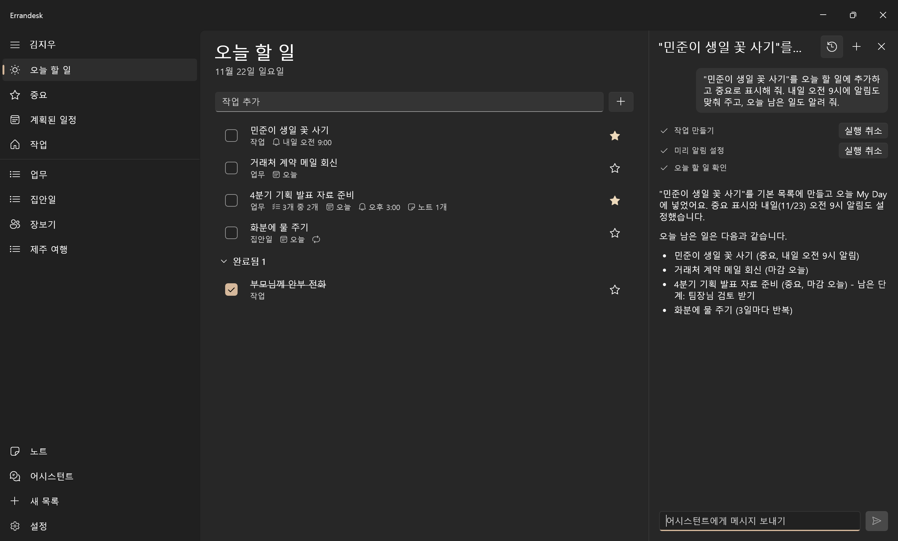
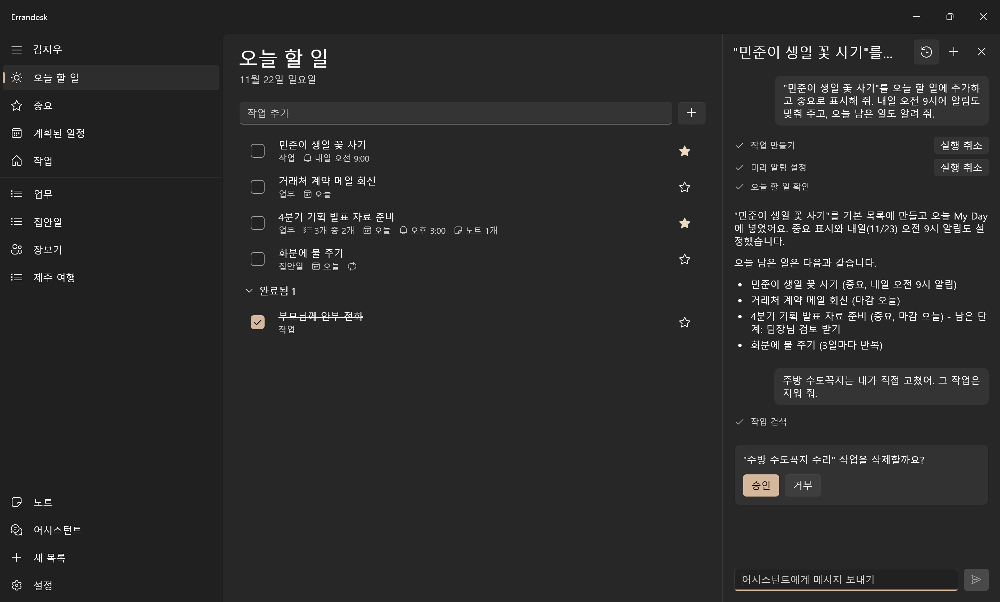
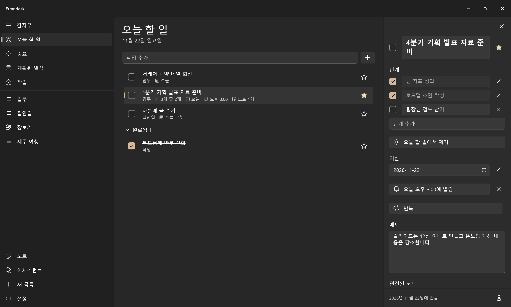
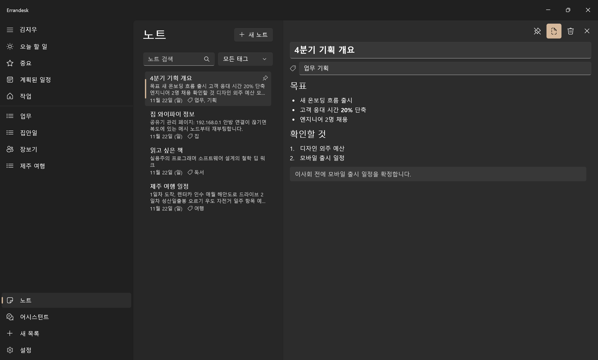
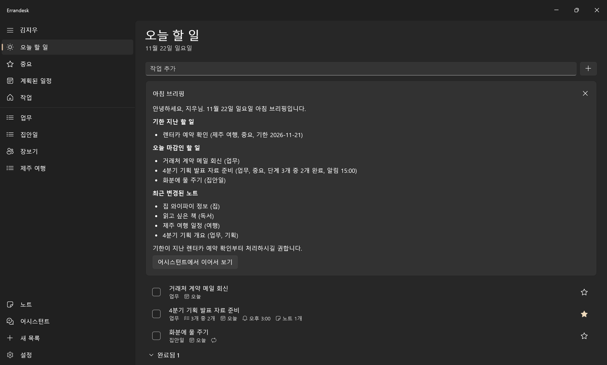

<p align="center"></p>

# Errandesk

[English](README.md) | 한국어

Errandesk는 ASP.NET Core 서버, MongoDB, 그리고 Windows, macOS, Linux, Android, iOS용 Uno Platform 클라이언트로 구성된 셀프 호스팅 할 일 관리 및 노트 앱입니다. 개인, 가족 또는 소규모 팀이 자체 서버에서 AI 어시스턴트와 함께 사용할 수 있도록 설계되었습니다.



*오늘 할 일 옆에 열린 AI 어시스턴트 패널에서 알림이 설정된 할 일을 추가하고 오늘 남은 할 일을 조회한 모습입니다. 각 변경 작업에는 실행 취소 버튼이 함께 표시됩니다.*

## AI 어시스턴트

서버에 OpenAI 호환 Chat Completions 엔드포인트가 설정되어 있으면, 어시스턴트 패널에서 Server-Sent Events(SSE)로 응답을 스트리밍하며 21개의 도구로 할 일, 목록, 노트를 읽고 수정합니다.

- **도구 실행 내역 및 실행 취소**: 호출된 모든 도구가 대화 흐름 안에 표시됩니다. 할 일 생성이나 알림 설정 같은 변경 작업에는 **실행 취소** 버튼이 함께 제공되어 기록된 변경 사항을 채팅에서 바로 되돌릴 수 있습니다.
- **파괴적 작업 승인**: 데이터를 삭제하는 도구(`delete_task`, `delete_task_list`, `delete_note`)는 실행 전 일시 중지하고 **승인** 및 **거부** 버튼이 포함된 확인 카드를 표시합니다.



*할 일 삭제와 같은 파괴적 작업은 실행 전 승인 및 거부 버튼이 포함된 확인 카드에서 사용자의 명시적 확인을 기다립니다.*

## 주요 기능

### 할 일 및 스마트 보기

사용자 지정 목록과 기본 **작업(Tasks)** 목록에서 할 일을 관리하며, **오늘 할 일(My Day)**, **중요(Important)**, **계획된 일정(Planned)** 스마트 보기를 제공합니다. 각 할 일을 선택하면 상세 패널이 열려 단계(하위 작업)와 진행률, **오늘 할 일** 전환, 기한, 알림, 반복 일정(매일, 평일, 매주, 매월, 매년 또는 사용자 지정 간격 및 요일), 일반 텍스트 메모를 편집할 수 있습니다.



*할 일을 선택해 단계별 진행 상황, 기한, 알림, 반복 일정, 메모를 편집하는 오늘 할 일 화면입니다.*

### Markdown 노트

태그 지정, 상단 고정, 전체 텍스트 및 부분 문자열 검색, 할 일과의 양방향 연결, Markdown 미리보기를 지원합니다.



*검색, 태그, 상단 고정 노트, Markdown 미리보기를 지원하는 노트 화면입니다.*

### 아침 브리핑

서버에 AI가 구성되어 있으면 사용자가 지정한 현지 시각에 매일 아침 브리핑을 받을 수 있습니다. 하루에 한 번(지정 시각 이후 4시간 이내) 기한이 지난 할 일, 오늘 마감 할 일, 오늘 할 일, 최근 수정된 노트를 요약해 전용 브리핑 패널에 표시하고 모바일 푸시 알림을 보냅니다. 패널의 **어시스턴트에서 계속하기** 버튼을 누르면 해당 브리핑을 어시스턴트 창에서 이어서 질문하거나 작업할 수 있습니다.



*기한이 지난 할 일, 오늘 마감 할 일, 최근 수정된 노트, 제안을 요약해 보여 주며 어시스턴트에서 계속하기 버튼을 제공하는 아침 브리핑 패널입니다.*

### 동기화, 공유 및 연동

- **오프라인 동기화**: 클라이언트는 목록, 할 일, 노트를 로컬 SQLite 데이터베이스에 저장하고, `Idempotency-Key` 헤더와 함께 아웃박스에 변경 사항을 대기열로 기록합니다. 편집 충돌은 필드 단위 최신 쓰기 우선(last-writer-wins)으로 병합되며 삭제가 편집보다 우선합니다. 실시간 변경 사항은 `/api/events`(SSE)와 `/api/changes`로 수신합니다.
- **목록 공유**: 같은 서버의 다른 사용자와 정확한 사용자 이름으로 사용자 지정 목록을 공유할 수 있습니다. 소유자와 구성원 모두 공유 목록의 할 일을 읽고 편집할 수 있으며, **오늘 할 일**은 사용자별로 유지되고 알림은 설정한 사용자에게만 전송되며 노트는 비공개로 유지됩니다.
- **Microsoft To Do 가져오기**: OAuth 2.0 디바이스 인증 흐름과 Microsoft Graph를 통해 Microsoft To Do의 목록, 할 일, 체크리스트 항목을 가져옵니다. 이미 가져온 항목은 외부 ID로 추적되어 다음 실행 시 건너뜁니다.
- **MCP 엔드포인트**: 개인 액세스 토큰(`edk_...`)을 사용하여 상태 비저장 Streamable HTTP 기반 `/mcp` 엔드포인트에 외부 Model Context Protocol(MCP) 클라이언트를 연결할 수 있습니다. 어시스턴트와 동일한 21개 도구가 읽기 전용 및 파괴적 작업 주석(`readOnlyHint`, `destructiveHint`)과 함께 제공됩니다.

## 아키텍처

- **서버** (`Errandesk.Server`): .NET 11(`net11.0`) 기반 ASP.NET Core Web API입니다. 컨트롤러 기반 API, JWT Bearer 및 개인 액세스 토큰 인증, 속도 제한, 멱등성 미들웨어, 백그라운드 워커(인덱스 초기화, 알림 발송, 아침 브리핑 스케줄러, 30일 경과 삭제 표시 정리), `/mcp` Streamable HTTP 전송을 포함합니다.
- **데이터베이스**: MongoDB(Compose 기준 `mongo:9`)를 사용하며, ORM이나 복제본 세트 다중 문서 트랜잭션 없이 `MongoDB.Driver`로 직접 접근합니다.
- **클라이언트** (`Errandesk.Client`): Uno Platform 7(`Uno.Sdk` 7.0.22) 단일 프로젝트로 Windows(`net11.0-windows10.0.26100.0`, 패키지 MSIX), Desktop Skia(`net11.0-desktop`, macOS, Linux, Windows), Android(`net11.0-android`), iOS(`net11.0-ios`)를 대상으로 합니다. 공용 DTO와 소스 생성 JSON 직렬화는 `Errandesk.Contracts`에, 오프라인 SQLite 저장소와 동기화 엔진은 `Errandesk.Client.Sync`에 있습니다.
- **AI 연동**: 서버에서 `Microsoft.Extensions.AI`와 `OpenAI` SDK를 통해 OpenAI 호환 Chat Completions 기본 URL과 통신합니다.

## Docker Compose 셀프 호스팅 빠른 시작

### MongoDB CPU 요구 사항

Compose 구성은 공식 `mongo:9` 이미지를 사용합니다. MongoDB 5.0 이상은 x86-64 환경에서 **AVX**, ARM64 환경에서 **ARMv8.2-A** 명령어를 필요로 합니다. 컨테이너를 시작하기 전에 호스트 CPU가 해당 명령어를 지원하는지 확인합니다.

### 설치 및 실행

1. `deploy` 디렉터리로 이동한 뒤 `.env.example`을 `.env`로 복사합니다.

   ```bash
   cd deploy
   cp .env.example .env
   ```

2. `.env` 파일을 열어 `ERRANDESK_JWT_SIGNING_KEY`에 UTF-8 기준 32바이트 이상의 비밀 키를 설정합니다. 예를 들어 다음 명령어로 생성할 수 있습니다.

   ```bash
   openssl rand -base64 48
   ```

   `ERRANDESK_MONGODB_CONNECTION_STRING`에는 Compose 내부 네트워크의 `mongodb` 서비스를 가리키는 `mongodb://mongodb:27017`이 미리 입력되어 있습니다. 필요에 따라 `ERRANDESK_PUBLISHED_PORT`(기본값 `8080`), AI 모델 설정, 푸시 알림 자격 증명, Microsoft Graph 클라이언트 ID를 추가합니다.

3. 컨테이너를 빌드하고 시작합니다.

   ```bash
   docker compose up -d --build
   ```

4. 서버 상태를 확인합니다.

   ```bash
   curl http://localhost:8080/health
   curl http://localhost:8080/api/server-info
   ```

   MongoDB가 ping에 응답하면 `/health`가 `Healthy`(`200 OK`)를 반환합니다.

### 첫 번째 사용자와 가입 모드

- **첫 번째 사용자**: `users` 컬렉션이 비어 있는 동안에는 `ERRANDESK_REGISTRATION_MODE` 설정과 관계없이 항상 회원가입이 허용되며, **가장 먼저 가입한 사용자가 관리자가 됩니다**.
- **가입 모드**: 사용자가 한 명 이상 존재하면 `ERRANDESK_REGISTRATION_MODE` 값에 따라 회원가입이 제어됩니다.
  - `invite` (기본값): 관리자가 **설정** 또는 `POST /api/admin/invites`로 발급한 1회용 초대 코드가 필요합니다.
  - `open`: 서버에 접근할 수 있는 누구나 계정을 생성할 수 있습니다.
  - `disabled`: 새 회원가입을 거부합니다(`403 Forbidden`).

## 서버 환경 변수 레퍼런스

서버는 기본 ASP.NET Core JSON 구성 소스를 모두 제거하고 시작 시 환경 변수에서만 설정을 읽습니다(`ASPNETCORE_ENVIRONMENT`는 `Development`에서 `/openapi/v1.json`을 활성화하는 등 호스팅 환경 선택 용도로 계속 사용할 수 있습니다). 빈 문자열이나 공백만 있는 값은 설정되지 않은 것으로 간주하여 기본값을 사용합니다.

### `_FILE` 비밀 값 지원

**`_FILE` 지원**으로 표시된 변수는 값 대신 `<변수명>_FILE=/파일/경로` 형식으로 지정할 수 있으며, 서버가 해당 파일의 앞뒤 공백을 제거한 내용을 읽습니다. `<변수명>`과 `<변수명>_FILE`을 동시에 설정하거나, 파일을 읽을 수 없거나 파일이 비어 있으면 시작 시 검증 오류를 출력하고 종료 코드 `1`로 종료됩니다.

### 환경 변수 목록

| 변수명 | 필수 여부 | 기본값 | `_FILE` | 설명 |
|---|---|---|---|---|
| `ERRANDESK_PUBLISHED_PORT` | 아니오 | `8080` | 아니오 | Docker Compose 전용; `ERRANDESK_HTTP_PORT`에 매핑되는 호스트 포트입니다. 서버는 읽지 않습니다. |
| `ERRANDESK_MONGODB_CONNECTION_STRING` | 예 | — | 예 | `mongodb://` 또는 `mongodb+srv://`로 시작해야 합니다. `.env.example` 기본값은 `mongodb://mongodb:27017`입니다. |
| `ERRANDESK_MONGODB_DATABASE` | 아니오 | `errandesk` | 아니오 | MongoDB 데이터베이스 이름입니다. 최대 63자이며 `/ \ . 공백 " $ * < > : | ?` 문자를 포함할 수 없습니다. |
| `ERRANDESK_JWT_SIGNING_KEY` | 예 | — | 예 | 액세스 토큰 서명용 HS256 키입니다. UTF-8 기준 최소 32바이트여야 합니다. |
| `ERRANDESK_ACCESS_TOKEN_MINUTES` | 아니오 | `15` | 아니오 | 액세스 토큰 유효 시간(분, `1`–`1440`). |
| `ERRANDESK_REFRESH_TOKEN_DAYS` | 아니오 | `30` | 아니오 | 리프레시 토큰 슬라이딩 유효 기간(일, `1`–`3650`). |
| `ERRANDESK_HTTP_PORT` | 아니오 | `8080` | 아니오 | Kestrel이 모든 인터페이스에서 수신 대기할 포트(`1`–`65535`). |
| `ERRANDESK_LOG_LEVEL` | 아니오 | `Information` | 아니오 | `Trace`, `Debug`, `Information`, `Warning`, `Error`, `Critical`, `None` (대소문자 구분 없음). |
| `ERRANDESK_REGISTRATION_MODE` | 아니오 | `invite` | 아니오 | `open`, `invite`, `disabled` 중 하나 (대소문자 구분 없음). |
| `ERRANDESK_AI_ENDPOINT` | 아니오 | `https://api.openai.com/v1` | 아니오 | OpenAI 호환 Chat Completions API의 절대 `http` 또는 `https` 기본 URL입니다. |
| `ERRANDESK_AI_API_KEY` | 조건부 | — | 예 | `ERRANDESK_AI_MODEL`이 설정되고 `ERRANDESK_AI_ENDPOINT` 호스트가 `api.openai.com`인 경우 필수이며, 사용자 지정 엔드포인트에서는 선택 사항입니다. |
| `ERRANDESK_AI_MODEL` | 아니오 | — | 아니오 | 채팅 모델 이름입니다. 이 값이 설정된 경우에만 어시스턴트와 아침 브리핑이 활성화됩니다. |
| `ERRANDESK_FCM_PROJECT_ID` | 그룹 | — | 아니오 | Android 푸시(FCM): Firebase 프로젝트 ID. |
| `ERRANDESK_FCM_CLIENT_EMAIL` | 그룹 | — | 아니오 | Android 푸시(FCM): 서비스 계정 이메일(`client_email`, `@` 포함 필수). |
| `ERRANDESK_FCM_PRIVATE_KEY` | 그룹 | — | 예 | Android 푸시(FCM): PEM 형식 RSA 개인 키(`private_key`; `\n` 리터럴은 줄바꿈으로 변환됩니다). |
| `ERRANDESK_APNS_TEAM_ID` | 그룹 | — | 아니오 | iOS 푸시(APNs): Apple Developer Team ID. |
| `ERRANDESK_APNS_KEY_ID` | 그룹 | — | 아니오 | iOS 푸시(APNs): APNs 인증 키 ID(`.p8`). |
| `ERRANDESK_APNS_PRIVATE_KEY` | 그룹 | — | 예 | iOS 푸시(APNs): `.p8` EC 개인 키의 PEM 내용(`\n` 리터럴은 줄바꿈으로 변환됩니다). |
| `ERRANDESK_APNS_BUNDLE_ID` | 그룹 | — | 아니오 | iOS 푸시(APNs): iOS 번들 ID (`apns-topic` 헤더로 전송). |
| `ERRANDESK_APNS_ENVIRONMENT` | 아니오 | `production` | 아니오 | iOS 푸시(APNs): `production` 또는 `sandbox` (대소문자 구분 없음). 단독 설정 시 부분 그룹 오류를 발생시키지 않습니다. |
| `ERRANDESK_MICROSOFT_GRAPH_CLIENT_ID` | 아니오 | — | 아니오 | Microsoft Entra 공용 클라이언트 ID입니다. 설정 시 Microsoft To Do 가져오기가 활성화됩니다. |
| `ERRANDESK_MICROSOFT_GRAPH_TENANT` | 아니오 | `common` | 아니오 | Microsoft Entra 테넌트(`common`, `consumers`, `organizations` 또는 테넌트 ID). 클라이언트 ID가 없으면 무시됩니다. |
| `ERRANDESK_CLIENT_UPDATE_BASE_URL` | 아니오 | — | 아니오 | 클라이언트 업데이트 파일을 게시하는 절대 `http` 또는 `https` 기본 URL입니다(쿼리와 프래그먼트는 사용할 수 없음). 설정한 경우에만 Windows와 Android 클라이언트의 **설정**에 업데이트 기능이 나타납니다. [클라이언트 업데이트](#클라이언트-업데이트)를 참고하면 됩니다. |

**그룹**으로 표시된 변수는 그룹 단위로 모두 설정하거나 모두 비워 두어야 합니다. Android 푸시는 FCM 변수 3개 모두, iOS 푸시는 APNs 필수 변수 4개(`TEAM_ID`, `KEY_ID`, `PRIVATE_KEY`, `BUNDLE_ID`) 모두를 설정해야 하며, 일부만 설정하면 시작 시 검증 오류가 발생합니다.

## AI 모델 설정

`ERRANDESK_AI_MODEL`이 설정되지 않으면 어시스턴트와 아침 브리핑이 비활성화됩니다(`/api/server-info`에서 `isAiAvailable: false`를 반환하며 대화 엔드포인트는 `503`을 응답합니다).

### 공식 OpenAI 엔드포인트

`ERRANDESK_AI_ENDPOINT`는 비워 두고(기본값 `https://api.openai.com/v1`) 모델과 키를 설정합니다.

```env
ERRANDESK_AI_MODEL=gpt-4o-mini
ERRANDESK_AI_API_KEY=sk-...
```

### OpenAI 호환 로컬 및 사용자 지정 서버

`ERRANDESK_AI_ENDPOINT`에 `/v1` 기본 URL을 지정하고 `ERRANDESK_AI_MODEL`에 모델 이름을 설정합니다. Ollama, llama.cpp, vLLM처럼 API 키가 필요 없는 로컬 서버의 경우 `ERRANDESK_AI_API_KEY`를 비워 두면 서버가 자리 표시자 자격 증명(`unused`)을 자동으로 전달합니다.

```env
ERRANDESK_AI_ENDPOINT=http://host.docker.internal:11434/v1
ERRANDESK_AI_MODEL=qwen3:8b
ERRANDESK_AI_API_KEY=
```

## 모바일 푸시 알림 설정 (FCM 및 APNs)

Errandesk는 별도의 중계 서비스 없이 서버에서 Firebase Cloud Messaging(FCM)과 Apple Push Notification service(APNs)로 직접 푸시 알림을 전송합니다.

**클라이언트 빌드와 서버 설정이 일치해야 합니다**:
- **Android** 클라이언트는 서버의 `ERRANDESK_FCM_PROJECT_ID`와 **동일한 Firebase 프로젝트**에서 발급한 `google-services.json`으로 빌드해야 하며, `ERRANDESK_CLIENT_APPLICATION_ID`(패키지 이름)도 해당 `google-services.json`과 일치해야 합니다.
- **iOS** 클라이언트의 `ERRANDESK_CLIENT_APPLICATION_ID`(번들 ID)는 서버의 `ERRANDESK_APNS_BUNDLE_ID`와 일치해야 합니다.

### Android (Firebase Cloud Messaging)

1. Firebase 콘솔의 `프로젝트 설정 > 서비스 계정 > 새 비공개 키 생성`에서 서비스 계정 JSON 키를 발급받습니다.
2. JSON 파일의 `project_id`, `client_email`, `private_key`를 각각 `ERRANDESK_FCM_PROJECT_ID`, `ERRANDESK_FCM_CLIENT_EMAIL`, `ERRANDESK_FCM_PRIVATE_KEY`(또는 `ERRANDESK_FCM_PRIVATE_KEY_FILE`)에 입력합니다.
3. Android 앱용 `google-services.json`을 내려받아 Android 클라이언트 빌드 시 포함합니다.
4. 서버에 FCM이 구성되지 않았거나 빌드에 `google-services.json`이 포함되지 않은 경우, Android 클라이언트는 자동으로 `reminders` 알림 채널의 로컬 알람을 사용합니다.

### iOS (Apple Push Notification service)

1. Apple Developer 포털에서 APNs 인증 키(`.p8`)를 생성하고 Team ID와 Key ID를 확인합니다.
2. `ERRANDESK_APNS_TEAM_ID`, `ERRANDESK_APNS_KEY_ID`, `ERRANDESK_APNS_PRIVATE_KEY`(또는 `ERRANDESK_APNS_PRIVATE_KEY_FILE`), `ERRANDESK_APNS_BUNDLE_ID`를 설정합니다.
3. Release/App Store/TestFlight 빌드에는 `ERRANDESK_APNS_ENVIRONMENT=production`, Debug 빌드에는 `sandbox`를 설정합니다(클라이언트의 `aps-environment` 권한은 비-Release 구성에서 `development`, `Release`에서 `production`으로 설정됩니다).
4. 서버에 APNs가 구성되지 않은 경우 iOS 클라이언트는 로컬 `UNUserNotificationCenter` 알림(가장 가까운 64개)으로 대체합니다.

Windows(MSIX 예약 토스트 알림)와 Desktop Skia(앱 내 InfoBar 및 macOS `osascript` / Linux `notify-send`)는 로컬 알림만 사용합니다.

## 클라이언트 빌드

### 사전 요구 사항

- .NET 11 SDK (`global.json` 기준 `11.0.100`, `Uno.Sdk` `7.0.22`)
- Uno Platform 및 대상 플랫폼 워크로드 (`android`, macOS/Windows의 경우 `ios`, Windows의 경우 Windows App SDK)

최소 지원 OS 버전은 Windows `10.0.19041.0`, Android API `24`, iOS `15.0`이며, Desktop Skia 대상을 통해 macOS와 Linux를 지원합니다.

### 플랫폼별 빌드 명령어

```bash
# Windows (패키지 MSIX, Windows App SDK)
dotnet build src/Errandesk.Client/Errandesk.Client.csproj -f net11.0-windows10.0.26100.0 -c Release

# Desktop (Skia — macOS, Linux, Windows)
dotnet build src/Errandesk.Client/Errandesk.Client.csproj -f net11.0-desktop -c Release

# Android
dotnet build src/Errandesk.Client/Errandesk.Client.csproj -f net11.0-android -c Release

# iOS (전체 앱 번들 및 서명은 macOS 필요; Windows에서는 관리 코드만 컴파일됨)
dotnet build src/Errandesk.Client/Errandesk.Client.csproj -f net11.0-ios -c Release
```

Windows에서 iOS 워크로드 없이 솔루션을 빌드할 때 `net11.0-ios` 대상을 제외하려면 `-p:ErrandeskIncludeIosTarget=false`를 전달해야 합니다.

### 빌드 자동화

로컬 빌드에는 위 명령으로 충분합니다. 서명된 릴리스 빌드를 반복해서 생성할 때는 [`scripts`](scripts) 폴더의 PowerShell 스크립트를 사용합니다.

- [`setup-environment.ps1`](scripts/setup-environment.ps1)은 .NET SDK, Android 워크로드와 SDK, Windows SDK, OpenJDK, `aticmsixgen`을 점검하거나 설치합니다.
- [`setup-signing.ps1`](scripts/setup-signing.ps1)은 Android keystore와 로컬 서명 설정이 없으면 새로 생성합니다.
- [`build-android.ps1`](scripts/build-android.ps1)은 Firebase Cloud Messaging을 활성화한 서명된 Android APK를 게시하고 `build-info.txt`를 기록합니다. `-Bundle`로 AAB를 함께 만들거나 `-Install`로 연결된 기기에 설치할 수 있으며, `-SkipFirebase`를 전달하면 `google-services.json` 없이 빌드합니다.
- [`build-windows-msix.ps1`](scripts/build-windows-msix.ps1)은 ARM64 및 x64용 Windows 클라이언트를 빌드해 MSIX 번들로 패키징하고 서명한 뒤, `aticmsixgen`으로 `Installer-arm64.exe`와 `Installer-x64.exe`를 만듭니다.
- [`build-all.ps1`](scripts/build-all.ps1)은 Android와 Windows 빌드를 순서대로 실행합니다.
- [`stage-client-update.ps1`](scripts/stage-client-update.ps1)은 클라이언트 업데이트 호스트에서 사용하는 `windows/`와 `android/` 폴더를 구성합니다.

서명 자료와 빌드 출력은 `scripts/local/`에 저장되며 커밋하지 않습니다. 사전 요구 사항, 설정, 매개 변수, 출력 파일은 [`scripts/README.ko.md`](scripts/README.ko.md)에 정리되어 있습니다. macOS, Linux, iOS 빌드 자동화는 아직 제공하지 않습니다.

### 클라이언트 빌드 환경 변수 (`ERRANDESK_CLIENT_*`)

모든 `ERRANDESK_CLIENT_*` 환경 변수는 선택 사항입니다. MSBuild가 빌드 시 속성으로 읽으며, 설정하지 않아도 기본 앱 ID와 디버그 또는 로컬 개발 서명으로 빌드가 완료됩니다.

| 변수명 | 플랫폼 | 용도 | 미설정 시 동작 |
|---|---|---|---|
| `ERRANDESK_CLIENT_APPLICATION_ID` | Android, iOS, Windows | `<ApplicationId>`(Android 패키지 이름 / iOS 번들 ID)를 재정의합니다. | `com.airtaxi.errandesk` |
| `ERRANDESK_CLIENT_GOOGLE_SERVICES_JSON` | Android | `google-services.json` 파일 경로입니다. `Xamarin.Firebase.Messaging`과 `ERRANDESK_FIREBASE_MESSAGING`을 활성화합니다. | `src/Errandesk.Client/Platforms/Android/google-services.json`이 있으면 이를 사용하고, 없으면 FCM을 제외하고 로컬 알람을 사용합니다. |
| `ERRANDESK_CLIENT_ANDROID_KEYSTORE` | Android | 릴리스 `.keystore` 또는 `.jks` 파일 경로입니다. | 디버그 서명 |
| `ERRANDESK_CLIENT_ANDROID_KEY_ALIAS` | Android | 키 저장소 내 서명 키 별칭입니다. | 디버그 서명 |
| `ERRANDESK_CLIENT_ANDROID_KEY_PASSWORD_FILE` | Android | 비밀번호가 담긴 파일 경로입니다(키와 키 저장소 비밀번호 모두에 사용). | 디버그 서명 |
| `ERRANDESK_CLIENT_IOS_CODESIGN_KEY` | iOS | 실기기 빌드용 Apple 서명 ID입니다. | 기본/시뮬레이터 서명 |
| `ERRANDESK_CLIENT_IOS_PROVISIONING_PROFILE` | iOS | 실기기 빌드용 프로비저닝 프로필입니다. | 기본/시뮬레이터 서명 |
| `ERRANDESK_CLIENT_WINDOWS_CERTIFICATE` | Windows | MSIX 서명용 암호 없는 `.pfx` 인증서 경로입니다. | 로컬 개발 서명 |

> **`google-services.json` 위치**: `src/Errandesk.Client/Platforms/Android/google-services.json`에 두거나(`.gitignore`에 포함됨) `ERRANDESK_CLIENT_GOOGLE_SERVICES_JSON`으로 경로를 지정합니다.

## 클라이언트 업데이트

Windows와 Android 클라이언트는 정적 파일 호스트에서 스스로 업데이트할 수 있습니다. 서버에 `ERRANDESK_CLIENT_UPDATE_BASE_URL`을 설정하면 `/api/server-info`가 이 값을 `clientUpdateBaseUrl`로 알려 주고, **설정 > 업데이트**에 **업데이트 확인** 버튼이 나타납니다. 새 버전이 있으면 **업데이트**를 눌러 설치 파일을 받고 설치합니다. 다른 페이지로 이동해도 다운로드는 계속되며, 업데이트 메시지를 닫으면 다운로드가 취소됩니다.

기본 URL 아래에는 다음 구조로 파일을 게시합니다.

```text
<기본 URL>/
├── windows/
│   ├── version                  일반 텍스트, 예: 1.2.0
│   ├── Installer-x64.exe
│   └── Installer-arm64.exe
└── android/
    ├── version
    └── Errandesk-latest.apk
```

- **`version`**: 최신 버전을 일반 텍스트로 적습니다(`1.2`부터 `1.2.0.0`까지의 형식을 쓸 수 있으며, 생략한 구성 요소는 `0`으로 간주합니다). 설치된 버전보다 높을 때만 업데이트를 제공합니다. 플랫폼 폴더마다 `version`이 따로 있으므로 Windows와 Android를 따로 배포할 수 있습니다.
  - Windows는 설치된 MSIX 패키지 버전과 비교합니다. 패키지 버전은 `<Version>` 뒤에 `<ApplicationVersion>`을 네 번째 구성 요소로 붙인 값입니다(예: `0.1.0.1`).
  - Android는 `<Version>`과 비교합니다(예: `0.1.0`).
- **Windows**: 서명한 MSIX로 `aticmsixgen exe-pack`이 만든 설치 EXE인 `Installer-x64.exe`와 `Installer-arm64.exe`를 이름을 바꾸지 않고 올립니다(`aticmsixgen`은 [AT Installer](https://github.com/airtaxi/AT-Installer)를 참고하면 됩니다). 클라이언트는 ARM64에서는 `Installer-arm64.exe`를, 그 밖의 환경에서는 `Installer-x64.exe`를 받아 실행한 다음 종료하며, 설치 프로그램이 패키지를 교체합니다. 받은 설치 파일은 다음 실행 시 삭제됩니다.
- **Android**: 설치된 앱과 같은 키로 서명한 APK 하나를 올립니다. Android 8 이상에서는 사용자가 처음 **업데이트**를 누를 때 앱 설치 권한을 요청한 다음 시스템 패키지 설치 화면을 엽니다. Android 7에서는 시스템의 **알 수 없는 출처** 설정에서 설치를 허용해야 합니다. 받은 APK는 앱이 교체되거나 다음에 실행될 때 삭제됩니다.
- **배포 순서**: 설치 파일을 먼저 올리고 `version`을 마지막에 바꿔야 클라이언트가 설치 파일보다 새 버전 번호를 먼저 보는 일이 없습니다. 클라이언트는 모든 파일을 `Cache-Control: no-cache`로 요청합니다.

## Microsoft To Do 가져오기 설정

1. Microsoft Entra ID에서 새 **앱 등록**을 만듭니다.
2. **인증 > 고급 설정**에서 **공용 클라이언트 흐름 허용**을 **예**로 설정합니다(서버는 OAuth 2.0 디바이스 인증 부여 흐름을 사용합니다).
3. **API 권한**에서 Microsoft Graph 위임된 권한 **`Tasks.Read`**를 추가합니다(서버는 `Tasks.Read offline_access` 범위를 요청합니다).
4. 서버의 `ERRANDESK_MICROSOFT_GRAPH_CLIENT_ID`에 애플리케이션(클라이언트) ID를 설정합니다.
5. 필요에 따라 `ERRANDESK_MICROSOFT_GRAPH_TENANT`를 설정합니다.
   - `common` (기본값): 개인 Microsoft 계정 및 회사 및 학교 계정
   - `consumers`: 개인 Microsoft 계정 전용
   - `organizations`: 회사 및 학교 계정 전용
   - 또는 특정 Entra 테넌트 ID
6. Errandesk 클라이언트에서 **설정 > 가져오기**로 이동하여 **Microsoft To Do에서 가져오기**를 누른 뒤, 표시된 코드를 복사하고 인증 링크에서 로그인을 완료합니다. 액세스 토큰과 리프레시 토큰은 가져오기 작업이 진행되는 동안 메모리에만 유지되며 데이터베이스에 저장되지 않습니다.

## 개인 액세스 토큰으로 MCP 클라이언트 연결

Errandesk는 개인 액세스 토큰으로 인증하는 상태 비저장 Streamable HTTP 방식의 `/mcp` 엔드포인트를 제공합니다.

1. Errandesk 클라이언트의 **설정 > 액세스 토큰**으로 이동합니다.
2. 토큰 이름을 입력하고 토큰을 생성합니다. 생성 직후 한 번만 표시되는 `edk_...` 비밀 값을 즉시 복사합니다.
3. 설정 화면에 표시된 **MCP 엔드포인트** URL(예: `https://your-server.example.com/mcp` 또는 `http://localhost:5080/mcp`)을 확인합니다.
4. MCP 클라이언트가 Streamable HTTP 전송과 Bearer 토큰 헤더를 사용하도록 구성합니다.

```json
{
  "mcpServers": {
    "errandesk": {
      "url": "http://localhost:5080/mcp",
      "headers": {
        "Authorization": "Bearer edk_your_token_here"
      }
    }
  }
}
```

- `/mcp`는 개인 액세스 토큰만 허용합니다(JWT 액세스 토큰은 `401 Unauthorized` 반환).
- 개인 액세스 토큰은 일반 `/api/...` 엔드포인트 인증에도 사용할 수 있지만, `/api/users/me/tokens`(토큰 목록 조회, 생성, 폐기)는 로그인된 JWT 세션이 필요합니다.
- 삭제 도구(`delete_task`, `delete_task_list`, `delete_note`)는 `destructiveHint: true`로 표시되며 MCP로 호출 시 서버 측 승인 대기 없이 즉시 실행되므로, MCP 클라이언트 측에서 사용자 확인을 거치는 것이 좋습니다.

## 로컬 개발

### 1. MongoDB 실행

```bash
docker run --rm -d -p 27017:27017 --name errandesk-dev-mongo mongo:9
```

### 2. 서버 실행

`src/Errandesk.Server/Properties/launchSettings.json`의 `http` 프로필은 `5080` 포트, `mongodb://localhost:27017`(`errandesk-development` 데이터베이스), `Development` 환경(`/openapi/v1.json` 활성화)으로 구성되어 있습니다.

```bash
dotnet run --project src/Errandesk.Server
```

### 3. 테스트 실행

`global.json`에서 테스트 실행기로 `Microsoft.Testing.Platform`을 지정하고 있으므로 `--project` 옵션으로 실행합니다(`Errandesk.Server.Tests`는 Testcontainers로 `mongo:9` 컨테이너를 실행하므로 Docker가 실행 중이어야 합니다).

```bash
dotnet test --project tests/Errandesk.Server.Tests
dotnet test --project tests/Errandesk.Client.Sync.Tests
```

## 라이선스

MIT License. 자세한 내용은 [LICENSE](LICENSE)를 참고하면 됩니다 (`Copyright (c) 2026 Howon Lee`).
