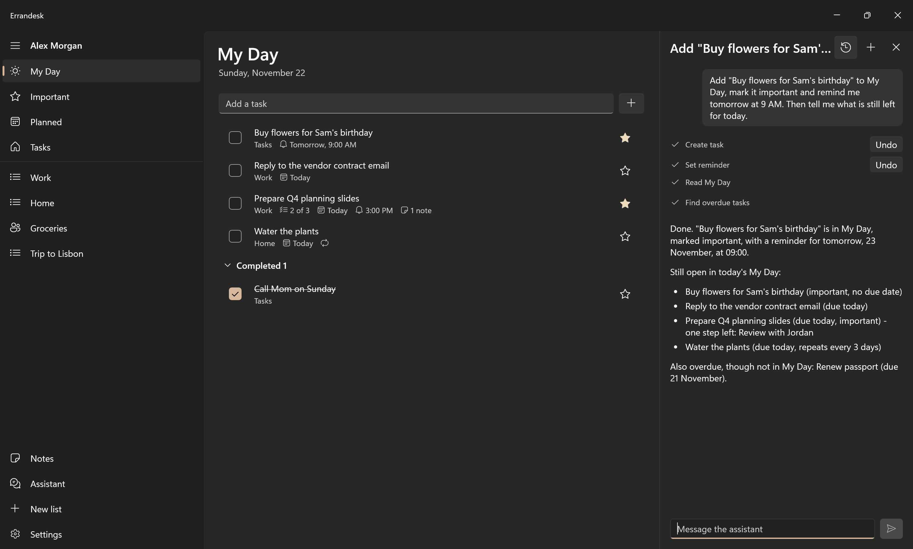
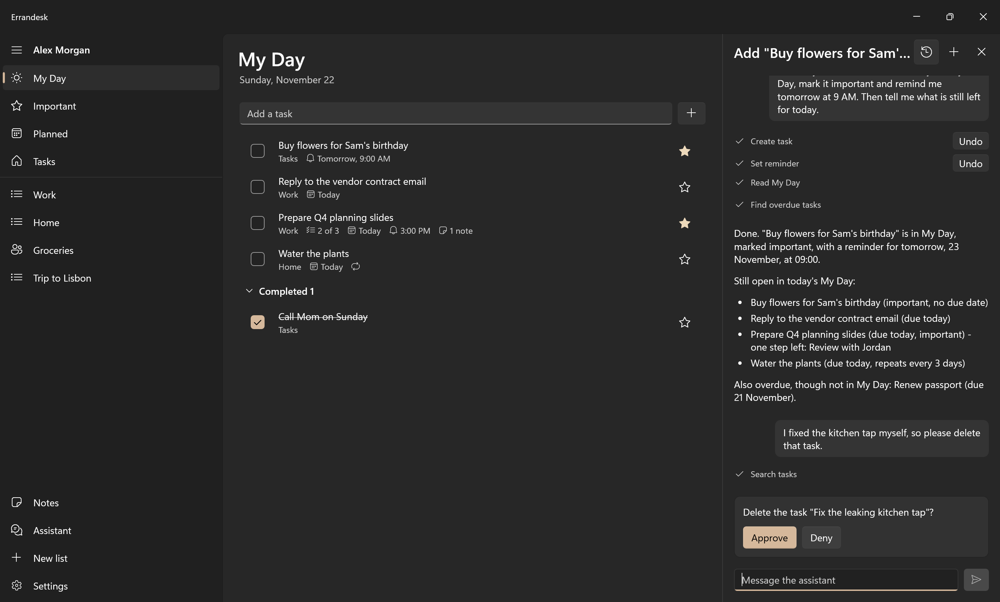
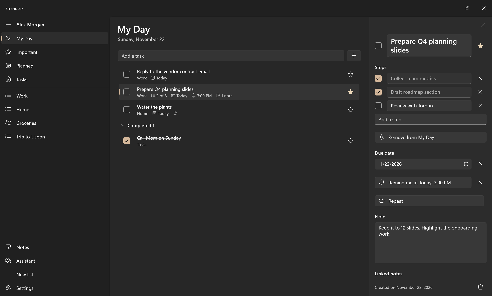
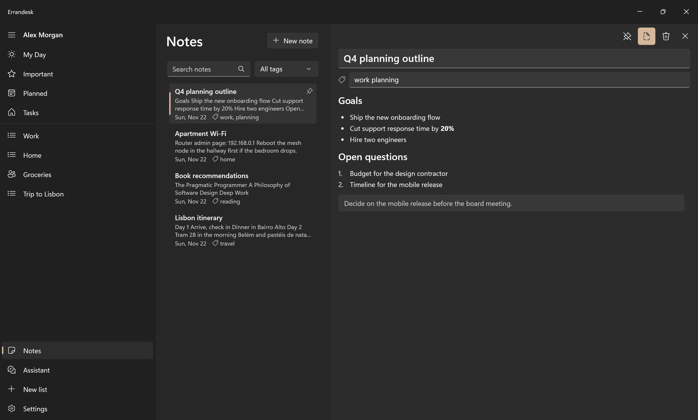
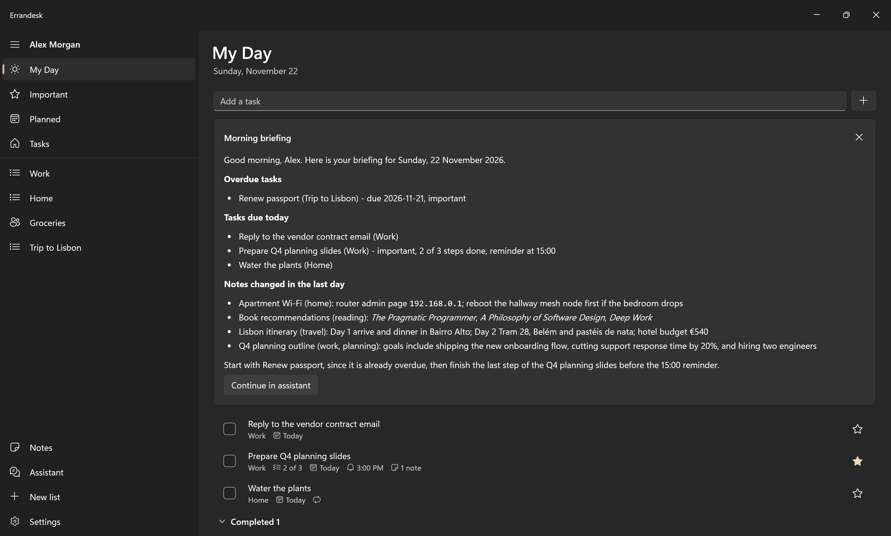

<p align="center"></p>

# Errandesk

English | [한국어](README.ko.md)

Errandesk is a self-hosted task manager and note-taking application with a server-side AI assistant, built with ASP.NET Core, MongoDB, and Uno Platform clients for Windows, macOS, Linux, Android, and iOS. It is designed for a single user, a family, or a small team running their own server.



*The AI assistant docked beside My Day after adding a task with a reminder and listing remaining tasks for the day, with Undo buttons on each change.*

## AI Assistant

When an OpenAI-compatible Chat Completions endpoint is configured on the server, Errandesk provides a docked assistant that streams responses over Server-Sent Events (SSE) and interacts with your workspace through 26 tools for reading and updating tasks, lists, and notes, as well as reading web pages.

- **Tool activity and Undo**: Every tool call appears inline in the conversation. Write operations (such as creating a task or setting a reminder) include an **Undo** button so recorded changes can be reverted directly from the chat.
- **Approval for destructive actions**: Tools that delete a task, list, or note (`delete_task`, `delete_task_list`, `delete_note`) pause execution and present an approval card with **Approve** and **Deny** buttons before anything is removed. Renaming or deleting a single step (`update_step`, `delete_step`) runs without an approval card and can be reverted with **Undo**.
- **Image attachments**: Attach up to 10 images per message using the attach button, pasting, or dragging files onto the conversation (pasting and dragging are supported on Windows and desktop). The client rotates each image upright, scales it to at most 2048 pixels on the longer side, and converts it to JPEG before upload. The server accepts JPEG, PNG, GIF, and WebP files up to 5 MB. Images are kept with the conversation and deleted with it, and the 20 most recent images from earlier messages are sent to the model again in later turns. The configured model must support image input.
- **Reading web pages**: When a message includes a URL or asks about a web page, the assistant reads it with `read_url` without an approval card (`read_url` is not exposed over `/mcp`).
  - **Server-side fetch and extraction**: The server downloads the page itself (HTML, plain text, Markdown, JSON, or XML up to 5 MB, with a 20-second timeout and at most 5 redirects). HTML main content is extracted and converted to Markdown, and text is given to the model in parts of up to 20,000 characters so the model can continue reading from the next position. Extracted pages are cached for 5 minutes per user so later parts are not downloaded again.
  - **Network and prompt safeguards**: Target addresses are checked when each connection opens, including after every redirect. Loopback, link-local (including cloud metadata addresses), multicast, and reserved addresses are always blocked, and private networks are blocked unless `ERRANDESK_AI_WEB_FETCH_ALLOW_PRIVATE_NETWORKS=true`. Page text is marked as external content, and the assistant is instructed not to follow instructions in it.
  - **Limitations and configuration**: Pages that need JavaScript to render and PDF files cannot be read. Set `ERRANDESK_AI_WEB_FETCH_ENABLED=false` to turn this feature off.



*Destructive actions such as deleting a task pause for explicit confirmation with Approve and Deny buttons.*

## Features

### Tasks and Smart Views

Organize tasks in custom lists and the default **Tasks** list, with **My Day**, **Important**, and **Planned** smart views. Each task opens in a detail pane with checklist steps and progress, **My Day** toggle, due dates, reminders, recurring schedules (daily, weekdays, weekly, monthly, yearly, or custom intervals and weekdays), and plain-text notes.



*My Day view with a task detail pane open for steps, due date, reminder, repeat schedule, and notes.*

### Markdown Notes

Write and preview Markdown notes with tags, pinning, full-text and substring search, and bidirectional linking to tasks.



*Notes view with search, tags, pinned notes, and rendered Markdown preview.*

### Morning Briefing

When AI is configured, users can enable a daily morning briefing at a chosen local time. Once per local day (within a 4-hour window), the server summarizes overdue tasks, tasks due today, My Day tasks, and recently changed notes into a dedicated briefing panel and sends a mobile push notification. From the panel, **Continue in assistant** opens the briefing in the assistant pane for follow-up questions or actions.



*Morning briefing panel summarizing overdue tasks, tasks due today, recently changed notes, and a suggestion, with a Continue in assistant button.*

### Sync, Sharing, and Integrations

- **Offline sync**: Clients store lists, tasks, and notes locally in SQLite and queue writes in an outbox with `Idempotency-Key` headers. Edits merge with per-field last-writer-wins semantics (deletions win over edits), and live updates arrive over `/api/events` (SSE) and `/api/changes`.
- **List sharing**: Share custom lists with other users on the same server by exact user name. Owners and members can read and edit shared tasks; **My Day** stays personal per user, reminders notify only the user who set them, and notes remain private.
- **Microsoft To Do import**: Import lists, tasks, and checklist items from Microsoft To Do using an OAuth 2.0 device authorization flow and Microsoft Graph. Previously imported items are tracked by external ID and skipped on subsequent runs.
- **MCP endpoint**: Connect external Model Context Protocol (MCP) clients to `/mcp` over stateless Streamable HTTP using personal access tokens (`edk_...`), exposing 25 assistant tools (all except `read_url`) with read-only and destructive annotations.

## Architecture

- **Server** (`Errandesk.Server`): ASP.NET Core Web API on .NET 11 (`net11.0`) using controllers, JWT Bearer and personal access token authentication, rate limiting, idempotency middleware, background workers (index initialization, reminder dispatch, morning briefing scheduler, 30-day tombstone purge), and `/mcp` Streamable HTTP transport.
- **Database**: MongoDB (`mongo:9` in Compose), accessed directly via `MongoDB.Driver` without an ORM or multi-document replica-set transactions.
- **Clients** (`Errandesk.Client`): Single Uno Platform 7 (`Uno.Sdk` 7.0.22) project targeting Windows (`net11.0-windows10.0.26100.0`, packaged MSIX), Desktop Skia (`net11.0-desktop` for macOS, Linux, and Windows), Android (`net11.0-android`), and iOS (`net11.0-ios`). Shared DTOs and source-generated JSON serialization live in `Errandesk.Contracts`, and offline SQLite storage and sync logic live in `Errandesk.Client.Sync`.
- **AI integration**: Runs on the server using `Microsoft.Extensions.AI` and the `OpenAI` SDK against any OpenAI-compatible Chat Completions base URL.

## Self-Hosting Quick Start (Docker Compose)

### MongoDB CPU requirement

The Compose stack uses the official `mongo:9` image. MongoDB 5.0 and later require **AVX** on x86-64 processors and **ARMv8.2-A** on ARM64 processors. Ensure your host CPU supports these instructions before starting the container.

### Setup and startup

1. Navigate to the `deploy` directory and copy `.env.example` to `.env`:

   ```bash
   cd deploy
   cp .env.example .env
   ```

2. Edit `.env` and set `ERRANDESK_JWT_SIGNING_KEY` to a secret that is at least 32 bytes long in UTF-8, for example:

   ```bash
   openssl rand -base64 48
   ```

   `ERRANDESK_MONGODB_CONNECTION_STRING` is prefilled as `mongodb://mongodb:27017` to connect to the `mongodb` service on the internal Compose network. Optionally set `ERRANDESK_PUBLISHED_PORT` (default `8080`), AI model settings, push notification credentials, or Microsoft Graph settings.

3. Build and start the stack:

   ```bash
   docker compose up -d --build
   ```

4. Verify the server is running:

   ```bash
   curl http://localhost:8080/health
   curl http://localhost:8080/api/server-info
   ```

   `/health` returns `Healthy` (`200 OK`) once MongoDB responds to a ping.

### First user and registration modes

- **First user**: When the `users` collection is empty, registration is always allowed regardless of `ERRANDESK_REGISTRATION_MODE`. The **first registered user becomes the administrator**.
- **Registration modes**: Once at least one user exists, `ERRANDESK_REGISTRATION_MODE` controls sign-up:
  - `invite` (default): Users must supply a single-use invite code generated by an administrator (in **Settings** or via `POST /api/admin/invites`).
  - `open`: Anyone who can reach the server can register an account.
  - `disabled`: New registrations are rejected (`403 Forbidden`).

## Server Configuration Reference

The server clears all default ASP.NET Core JSON configuration sources and reads settings exclusively from environment variables at startup (`ASPNETCORE_ENVIRONMENT` may still be used to select the hosting environment, such as `Development` to enable OpenAPI at `/openapi/v1.json`). Empty or whitespace-only values are treated as unset, falling back to their defaults.

### `_FILE` secret variants

Variables marked with **`_FILE` supported** can alternatively be provided as `<VARIABLE>_FILE=/path/to/file`, where the server reads and trims the file contents. Setting both `<VARIABLE>` and `<VARIABLE>_FILE`—or pointing `<VARIABLE>_FILE` to an unreadable or empty file—causes startup validation to fail and exit with code `1`.

### Environment variables

| Variable | Required | Default | `_FILE` | Notes |
|---|---|---|---|---|
| `ERRANDESK_PUBLISHED_PORT` | No | `8080` | No | Docker Compose only; host port mapped to `ERRANDESK_HTTP_PORT`. Not read by the server. |
| `ERRANDESK_MONGODB_CONNECTION_STRING` | Yes | — | Yes | Must start with `mongodb://` or `mongodb+srv://`. `.env.example` sets `mongodb://mongodb:27017`. |
| `ERRANDESK_MONGODB_DATABASE` | No | `errandesk` | No | MongoDB database name. Max 63 chars; cannot contain `/ \ . space " $ * < > : | ?`. |
| `ERRANDESK_JWT_SIGNING_KEY` | Yes | — | Yes | HS256 signing key for access tokens. Must be at least 32 bytes in UTF-8. |
| `ERRANDESK_ACCESS_TOKEN_MINUTES` | No | `15` | No | Access token lifetime in minutes (`1`–`1440`). |
| `ERRANDESK_REFRESH_TOKEN_DAYS` | No | `30` | No | Refresh token sliding lifetime in days (`1`–`3650`). |
| `ERRANDESK_HTTP_PORT` | No | `8080` | No | Port Kestrel listens on across all interfaces (`1`–`65535`). |
| `ERRANDESK_LOG_LEVEL` | No | `Information` | No | `Trace`, `Debug`, `Information`, `Warning`, `Error`, `Critical`, or `None` (case-insensitive). |
| `ERRANDESK_REGISTRATION_MODE` | No | `invite` | No | `open`, `invite`, or `disabled` (case-insensitive). |
| `ERRANDESK_AI_ENDPOINT` | No | `https://api.openai.com/v1` | No | Absolute `http` or `https` base URL of an OpenAI-compatible Chat Completions API. |
| `ERRANDESK_AI_API_KEY` | Conditional | — | Yes | Required when `ERRANDESK_AI_MODEL` is set and `ERRANDESK_AI_ENDPOINT` host is `api.openai.com`; optional for custom endpoints. |
| `ERRANDESK_AI_MODEL` | No | — | No | Chat model name. The assistant and morning briefing are enabled only when this is set. |
| `ERRANDESK_AI_WEB_FETCH_ENABLED` | No | `true` | No | `true` or `false` (case-insensitive). Enables or disables reading web pages with `read_url`. |
| `ERRANDESK_AI_WEB_FETCH_ALLOW_PRIVATE_NETWORKS` | No | `false` | No | `true` or `false` (case-insensitive). Lets `read_url` read pages on private networks (`10.0.0.0/8`, `172.16.0.0/12`, `192.168.0.0/16`, `100.64.0.0/10`, `fc00::/7`). Loopback, link-local, multicast, and reserved addresses remain blocked. |
| `ERRANDESK_FCM_PROJECT_ID` | Group | — | No | Android push (FCM): Firebase project ID. |
| `ERRANDESK_FCM_CLIENT_EMAIL` | Group | — | No | Android push (FCM): Service account email (`client_email`, must contain `@`). |
| `ERRANDESK_FCM_PRIVATE_KEY` | Group | — | Yes | Android push (FCM): PEM-encoded RSA private key (`private_key`; literal `\n` sequences are converted to line breaks). |
| `ERRANDESK_APNS_TEAM_ID` | Group | — | No | iOS push (APNs): Apple Developer Team ID. |
| `ERRANDESK_APNS_KEY_ID` | Group | — | No | iOS push (APNs): APNs authentication key ID (`.p8`). |
| `ERRANDESK_APNS_PRIVATE_KEY` | Group | — | Yes | iOS push (APNs): PEM content of the `.p8` EC private key (literal `\n` sequences are converted to line breaks). |
| `ERRANDESK_APNS_BUNDLE_ID` | Group | — | No | iOS push (APNs): iOS bundle ID, sent as the `apns-topic` header. |
| `ERRANDESK_APNS_ENVIRONMENT` | No | `production` | No | iOS push (APNs): `production` or `sandbox` (case-insensitive). Setting this alone does not trigger a partial group error. |
| `ERRANDESK_MICROSOFT_GRAPH_CLIENT_ID` | No | — | No | Microsoft Entra public client ID. Enables Microsoft To Do import when set. |
| `ERRANDESK_MICROSOFT_GRAPH_TENANT` | No | `common` | No | Microsoft Entra tenant (`common`, `consumers`, `organizations`, or tenant ID). Ignored if client ID is unset. |
| `ERRANDESK_CLIENT_UPDATE_BASE_URL` | No | — | No | Absolute `http` or `https` base URL where client updates are published (no query or fragment). The Windows and Android clients offer updates in **Settings** only when this is set. See [Client Updates](#client-updates). |

Variables marked **Group** are all-or-nothing per group: set all three FCM variables to enable Android push, and set all four required APNs variables (`TEAM_ID`, `KEY_ID`, `PRIVATE_KEY`, `BUNDLE_ID`) to enable iOS push. A partially configured group fails startup validation.

## AI Model Setup

The assistant and morning briefing are disabled unless `ERRANDESK_AI_MODEL` is set (when unset, `/api/server-info` reports `isAiAvailable: false` and conversation endpoints return `503`).

### Official OpenAI endpoint

Leave `ERRANDESK_AI_ENDPOINT` unset (it defaults to `https://api.openai.com/v1`) and set:

```env
ERRANDESK_AI_MODEL=gpt-4o-mini
ERRANDESK_AI_API_KEY=sk-...
```

### OpenAI-compatible local or custom servers

Set `ERRANDESK_AI_ENDPOINT` to the server's `/v1` base URL and `ERRANDESK_AI_MODEL` to the served model name. For local servers that do not require authentication (such as Ollama, llama.cpp, or vLLM), leave `ERRANDESK_AI_API_KEY` empty—the server sends a placeholder credential (`unused`) automatically:

```env
ERRANDESK_AI_ENDPOINT=http://host.docker.internal:11434/v1
ERRANDESK_AI_MODEL=qwen3:8b
ERRANDESK_AI_API_KEY=
```

## Mobile Push Setup (FCM and APNs)

Errandesk sends push notifications directly from the server to Firebase Cloud Messaging (FCM) and Apple Push Notification service (APNs) without a relay service.

**Matching client and server builds is required**:
- On **Android**, the client must be built with the `google-services.json` from the **same Firebase project** configured in `ERRANDESK_FCM_PROJECT_ID`, and its `ERRANDESK_CLIENT_APPLICATION_ID` (package name) must match that `google-services.json`.
- On **iOS**, the client's `ERRANDESK_CLIENT_APPLICATION_ID` (bundle ID) must match `ERRANDESK_APNS_BUNDLE_ID`.

### Android (Firebase Cloud Messaging)

1. In the Firebase Console, generate a service account JSON key (`Project settings > Service accounts > Generate new private key`).
2. Copy `project_id`, `client_email`, and `private_key` into `ERRANDESK_FCM_PROJECT_ID`, `ERRANDESK_FCM_CLIENT_EMAIL`, and `ERRANDESK_FCM_PRIVATE_KEY` (or `ERRANDESK_FCM_PRIVATE_KEY_FILE`).
3. Download `google-services.json` for your Android app and provide it when building the Android client.
4. When FCM is not configured on the server or `google-services.json` is omitted at build time, the Android client automatically schedules local alarms on the `reminders` notification channel instead.

### iOS (Apple Push Notification service)

1. In the Apple Developer portal, create an APNs authentication key (`.p8`) and note your Team ID and Key ID.
2. Set `ERRANDESK_APNS_TEAM_ID`, `ERRANDESK_APNS_KEY_ID`, `ERRANDESK_APNS_PRIVATE_KEY` (or `ERRANDESK_APNS_PRIVATE_KEY_FILE`), and `ERRANDESK_APNS_BUNDLE_ID`.
3. Set `ERRANDESK_APNS_ENVIRONMENT` to `production` for Release/App Store/TestFlight builds or `sandbox` for Debug builds (the client's `aps-environment` entitlement is `development` in non-Release configurations and `production` in `Release`).
4. When APNs is not configured on the server, the iOS client falls back to local `UNUserNotificationCenter` notifications (up to the nearest 64 reminders).

Windows (MSIX scheduled toast notifications) and Desktop Skia (in-app InfoBar, plus `osascript` on macOS and `notify-send` on Linux) use local notifications only.

## Building the Clients

### Prerequisites

- .NET 11 SDK (`11.0.100` per `global.json`, which pins `Uno.Sdk` `7.0.22`)
- Uno Platform and target workloads (`android`, `ios` on macOS/Windows, Windows App SDK for Windows)

Minimum supported OS versions: Windows `10.0.19041.0`, Android API `24`, iOS `15.0`, plus macOS and Linux via the Skia desktop head.

### Build commands

```bash
# Windows (packaged MSIX, Windows App SDK)
dotnet build src/Errandesk.Client/Errandesk.Client.csproj -f net11.0-windows10.0.26100.0 -c Release

# Desktop (Skia — macOS, Linux, and Windows)
dotnet build src/Errandesk.Client/Errandesk.Client.csproj -f net11.0-desktop -c Release

# Android
dotnet build src/Errandesk.Client/Errandesk.Client.csproj -f net11.0-android -c Release

# iOS (full app bundle and signing require macOS; on Windows this compiles managed code only)
dotnet build src/Errandesk.Client/Errandesk.Client.csproj -f net11.0-ios -c Release
```

To skip the `net11.0-ios` target when building the solution on Windows without the iOS workload, pass `-p:ErrandeskIncludeIosTarget=false`.

### Build automation

The commands above cover local builds. For repeatable, signed release builds, use the PowerShell scripts in [`scripts`](scripts):

- [`setup-environment.ps1`](scripts/setup-environment.ps1) checks or installs the .NET SDK, Android workload and SDK, Windows SDK, OpenJDK, and `aticmsixgen`.
- [`setup-signing.ps1`](scripts/setup-signing.ps1) creates an Android keystore and local signing settings when they do not exist.
- [`build-android.ps1`](scripts/build-android.ps1) publishes a signed Android APK with Firebase Cloud Messaging enabled, writes `build-info.txt`, and optionally produces an AAB (`-Bundle`) or installs on a connected device (`-Install`). Pass `-SkipFirebase` to build without `google-services.json`.
- [`build-windows-msix.ps1`](scripts/build-windows-msix.ps1) builds the Windows client for ARM64 and x64, packs and signs an MSIX bundle, and creates `Installer-arm64.exe` and `Installer-x64.exe` with `aticmsixgen`.
- [`build-all.ps1`](scripts/build-all.ps1) runs the Android and Windows builds in sequence.
- [`stage-client-update.ps1`](scripts/stage-client-update.ps1) stages the `windows/` and `android/` folders used by the client update host.

Signing material and build outputs stay in `scripts/local/`, which is not committed. See [`scripts/README.md`](scripts/README.md) for prerequisites, settings, parameters, and outputs. Build automation for macOS, Linux, and iOS is not available yet.

### Client build-time variables (`ERRANDESK_CLIENT_*`)

All `ERRANDESK_CLIENT_*` environment variables are optional. MSBuild reads them as properties during the build; when unset, builds succeed with default IDs and debug or local development signing.

| Variable | Platform | Purpose | When unset |
|---|---|---|---|
| `ERRANDESK_CLIENT_APPLICATION_ID` | Android, iOS, Windows | Overrides `<ApplicationId>` (Android package name / iOS bundle ID). | `com.airtaxi.errandesk` |
| `ERRANDESK_CLIENT_GOOGLE_SERVICES_JSON` | Android | Path to `google-services.json`. Enables `Xamarin.Firebase.Messaging` and `ERRANDESK_FIREBASE_MESSAGING`. | Uses `src/Errandesk.Client/Platforms/Android/google-services.json` if present; otherwise FCM is compiled out and local alarms are used. |
| `ERRANDESK_CLIENT_ANDROID_KEYSTORE` | Android | Path to the release `.keystore` / `.jks` file. | Debug signing |
| `ERRANDESK_CLIENT_ANDROID_KEY_ALIAS` | Android | Signing key alias inside the keystore. | Debug signing |
| `ERRANDESK_CLIENT_ANDROID_KEYSTORE_PASSWORD_FILE` | Android | Path to a file containing the keystore password. When unset, the key password file is used for both. | Debug signing |
| `ERRANDESK_CLIENT_ANDROID_KEY_PASSWORD_FILE` | Android | Path to a file containing the key alias password. | Debug signing |
| `ERRANDESK_CLIENT_IOS_CODESIGN_KEY` | iOS | Apple signing identity for device builds. | Default/simulator signing |
| `ERRANDESK_CLIENT_IOS_PROVISIONING_PROFILE` | iOS | Provisioning profile for device builds. | Default/simulator signing |
| `ERRANDESK_CLIENT_WINDOWS_CERTIFICATE` | Windows | Path to a passwordless `.pfx` certificate for MSIX signing. | Local development signing |

> **Where `google-services.json` goes**: Place it at `src/Errandesk.Client/Platforms/Android/google-services.json` (gitignored) or point `ERRANDESK_CLIENT_GOOGLE_SERVICES_JSON` to its path.

## Client Updates

The Windows and Android clients can update themselves from a static file host. Set `ERRANDESK_CLIENT_UPDATE_BASE_URL` on the server; `/api/server-info` then reports it as `clientUpdateBaseUrl`, and **Settings > Updates** shows a **Check for updates** button. When a newer version is found, **Update** downloads the package and installs it. The download continues while the user moves to other pages, and closing the update message cancels it.

Publish the files below the base URL with this layout:

```text
<base URL>/
├── windows/
│   ├── version                  plain text, for example 1.2.0
│   ├── Installer-x64.exe
│   └── Installer-arm64.exe
└── android/
    ├── version
    └── Errandesk-latest.apk
```

- **`version`**: The latest version as plain text (`1.2` through `1.2.0.0` forms; missing components count as `0`). An update is offered only when it is higher than the installed version. Each platform folder has its own `version`, so Windows and Android can be released separately.
  - Windows compares it with the version of the installed MSIX package, which is `<Version>` followed by `<ApplicationVersion>` as the fourth component (for example `0.1.0.1`).
  - Android compares it with `<Version>` (for example `0.1.0`).
- **Windows**: Upload `Installer-x64.exe` and `Installer-arm64.exe`, the installer EXEs that `aticmsixgen exe-pack` creates from the signed MSIX, without renaming them (see [AT Installer](https://github.com/airtaxi/AT-Installer) for `aticmsixgen`). The client downloads `Installer-arm64.exe` on ARM64 and `Installer-x64.exe` otherwise, starts it, and exits; the installer replaces the package. The downloaded installer is deleted on the next launch.
- **Android**: A single APK signed with the same key as the installed app. On Android 8 and later, the client asks for permission to install apps the first time the user selects **Update**, then opens the system package installer. On Android 7, the system's **Unknown sources** setting must allow the installation. The downloaded APK is deleted once the app is replaced, or on the next launch.
- **Release order**: Upload the packages first and replace `version` last, so a client never sees a new version number before its package is available. Clients request every file with `Cache-Control: no-cache`.

## Microsoft To Do Import Setup

1. In Microsoft Entra ID, create a new **App registration**.
2. Under **Authentication > Advanced settings**, set **Allow public client flows** to **Yes** (the server uses the OAuth 2.0 device authorization grant).
3. Under **API permissions**, add the Microsoft Graph delegated permission **`Tasks.Read`** (the server requests `Tasks.Read offline_access`).
4. Set `ERRANDESK_MICROSOFT_GRAPH_CLIENT_ID` on the server to the Application (client) ID.
5. Optionally set `ERRANDESK_MICROSOFT_GRAPH_TENANT`:
   - `common` (default): personal Microsoft accounts as well as work and school accounts
   - `consumers`: personal Microsoft accounts only
   - `organizations`: work and school accounts only
   - Or a specific Entra tenant ID
6. In the Errandesk client, go to **Settings > Import**, click **Import from Microsoft To Do**, copy the user code, and complete sign-in at the displayed verification URL. Access and refresh tokens are held in memory only for the duration of the import job and are not stored in the database.

## Connecting MCP Clients

Errandesk exposes a stateless Streamable HTTP MCP endpoint at `/mcp` authenticated with personal access tokens.

1. In the Errandesk client, open **Settings > Access tokens**.
2. Enter a name and create a token. Copy the `edk_...` secret immediately—it is displayed only once.
3. Note the **MCP endpoint** URL shown in Settings (for example `https://your-server.example.com/mcp` or `http://localhost:5080/mcp`).
4. Configure your MCP client to connect over Streamable HTTP with a Bearer token header:

```json
{
  "mcpServers": {
    "errandesk": {
      "url": "http://localhost:5080/mcp",
      "headers": {
        "Authorization": "Bearer edk_your_token_here"
      }
    }
  }
}
```

- `/mcp` accepts personal access tokens only (JWT access tokens receive `401 Unauthorized`).
- Personal access tokens also authenticate standard `/api/...` endpoints, except `/api/users/me/tokens` (token management requires a signed-in JWT session).
- Destructive tools (`delete_task`, `delete_task_list`, `delete_note`, `delete_step`) advertise `destructiveHint: true` and execute immediately when invoked over MCP without a server-side approval pause; MCP clients should confirm with the user before calling them.

## Local Development

### 1. Start MongoDB

```bash
docker run --rm -d -p 27017:27017 --name errandesk-dev-mongo mongo:9
```

### 2. Run the server

`src/Errandesk.Server/Properties/launchSettings.json` provides a `Development` profile (`http`) on port `5080` connected to `mongodb://localhost:27017` (`errandesk-development` database) with OpenAPI enabled at `/openapi/v1.json`:

```bash
dotnet run --project src/Errandesk.Server
```

### 3. Run tests

`global.json` configures `Microsoft.Testing.Platform` as the test runner. Run each test project with `--project` (Docker must be running for `Errandesk.Server.Tests`, which starts a `mongo:9` container via Testcontainers):

```bash
dotnet test --project tests/Errandesk.Server.Tests
dotnet test --project tests/Errandesk.Client.Sync.Tests
```

## License

MIT License. See [LICENSE](LICENSE) (`Copyright (c) 2026 Howon Lee`).
